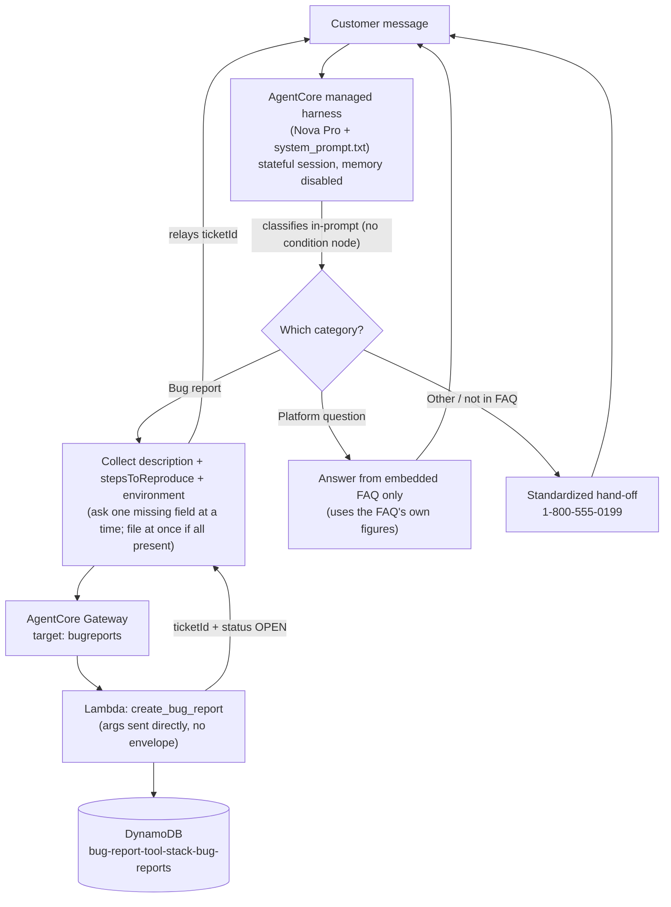

# Architecture & Routing

This document collects three of the submission artifacts the runbook asks for: the
architecture diagram, the classifier-prompt reference, and the routing-conditions table.

## System diagram

In AgentCore there are no condition nodes or a separate classifier resource: the harness
runs one agent loop, and the single system prompt does all routing. The diagram reflects
that - one model+prompt box, three outcomes, with only the bug-report outcome reaching the
tool/gateway/Lambda/DynamoDB path.

> The transcript you submit must come from *this* system. If your `bug-report-transcript.txt`
> shows a tool call, it should be the `bugreports___create_bug_report` line this diagram
> describes - the diagram and the evidence have to match, or it reads as inconsistent.

## Classifier prompt (it lives in the prompt, not a node)

There is no separate classifier node in AgentCore. The "classifier" is STEP 1 of
`system_prompt.txt`, which instructs the model to silently pick exactly one of three
categories before responding. The relevant excerpt:

- **BUG REPORT** - something on the site/app is broken; a checkout or website error is a bug.
- **PLATFORM QUESTION** - answerable from the FAQ (orders, shipping, returns, payments,
  products, account, privacy); a late/missing package and a declined card are FAQ questions,
  not bugs.
- **OTHER** - neither of the above: account/order-specific actions, requests for a human, and
  anything the FAQ doesn't cover.

## Routing-conditions table

AgentCore has no condition-node expressions; each routing decision is implemented by a prompt
rule. This table maps the decision to the rule that implements it.

| Routing decision | Prompt rule that implements it |
|---|---|
| Website/checkout error -> Bug report | STEP 1, category 1: "A checkout or website error is a BUG REPORT." |
| Late/missing/"delivered not found" package -> Platform question | STEP 1, category 2: explicit anchor that a late/missing package is a PLATFORM QUESTION (FAQ shipping). |
| Declined payment -> Platform question | STEP 1, category 2: explicit anchor that a declined payment is a PLATFORM QUESTION (FAQ payments). |
| General policy question -> Platform question | STEP 1, category 2 vs 3 distinction: general policy is a PLATFORM QUESTION. |
| Account/order-specific action -> Other | STEP 1, category 3: "a request to actually perform or look up something on a specific account or order is OTHER." |
| Request for a human / topic not in FAQ -> Other | STEP 1, category 3: explicit request to talk to a person, and topics the FAQ doesn't cover (e.g., student discount). |
| Ambiguous / too short -> clarify | STEP 1 closing rule: ask ONE brief clarifying question instead of guessing. |
| All three bug fields present -> file at once | BUG REPORT behavior: "If the customer's message already contains all three fields, call create_bug_report immediately." |
| Bug fields missing -> collect one at a time | BUG REPORT behavior: "ask for exactly ONE missing field at a time." |
| Environment is a browser/OS/device, not an action | BUG REPORT behavior: "An action is never an environment." |
| FAQ doesn't cover it -> hand off | PLATFORM QUESTION behavior + standardized OTHER hand-off message. |
| Every hand-off uses the same wording -> consistent transfer | OTHER behavior: the exact verbatim hand-off line to 1-800-555-0199. |
